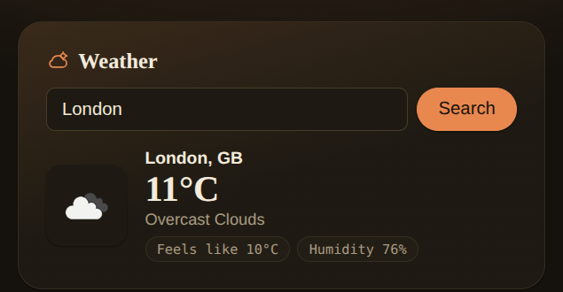

# Task Manager

A full-stack task manager with a weather lookup widget. Add, edit, complete and delete
tasks from a responsive React UI backed by a small Express/MongoDB REST API, plus a
server-side proxy for current weather conditions by city.

## Features

- Create, edit (inline), complete, and delete tasks
- "X of Y remaining" counter
- Loading, empty, and error states for the task list
- Weather lookup by city (temperature, feels-like, humidity, description, icon)
- Input validation and consistent error responses from the API
- Responsive layout (mobile and desktop)
- Accessible form controls (labelled inputs/checkboxes, keyboard-operable editing)

## Tech stack

| Layer    | Technology                          |
| -------- | ------------------------------------ |
| Frontend | React 19 (Vite), plain CSS           |
| Backend  | Node.js, Express 4                   |
| Database | MongoDB (Mongoose)                   |
| External | OpenWeather Current Weather API      |
| Testing  | Jest + Supertest (API), Vitest + React Testing Library (client) |

## Project structure

```
task_manager/
├── server/            Express API
│   ├── models/         Mongoose schemas
│   ├── routes/         Route handlers (tasks, weather, health)
│   ├── middleware/      Central error handler
│   ├── utils/          asyncHandler, ObjectId validation
│   └── tests/          Jest + Supertest suite
└── client/            React (Vite) app
    ├── src/
    │   ├── api.js            All HTTP calls to the backend
    │   ├── App.jsx           Task list + layout
    │   └── components/        TaskItem, WeatherWidget
    └── src/__tests__/        Vitest + RTL suite
```

## Setup instructions

### Prerequisites

- Node.js 18+ and npm
- A MongoDB connection string (a local `mongod` instance or a MongoDB Atlas cluster)
- An [OpenWeather](https://openweathermap.org/api) API key (free tier is enough)

### Backend setup

```bash
cd server
npm install
cp .env.example .env   # fill in MONGO_URI, CLIENT_URL, OPENWEATHER_API_KEY
npm run dev            # starts the API on PORT (default 5000)
```

Run the automated test suite (uses an in-memory MongoDB instance, no real database needed):

```bash
npm test
```

### Frontend setup

```bash
cd client
npm install
npm run dev             # starts the Vite dev server (default http://localhost:5173)
```

```bash
npm test -- --run        # run the Vitest suite
npm run build            # production build
```

### Environment variables

| Variable              | Used by | Description                                            |
| ---------------------- | ------- | -------------------------------------------------------- |
| `PORT`                 | server  | Port the Express server listens on (default `5000`)      |
| `MONGO_URI`            | server  | MongoDB connection string                                 |
| `CLIENT_URL`           | server  | Origin allowed by CORS (the frontend's URL)               |
| `OPENWEATHER_API_KEY`  | server  | API key for the OpenWeather current-weather endpoint      |
| `VITE_API_URL`         | client  | Base URL of the API (default `http://localhost:5000/api`) |

The backend ships a `server/.env.example` with placeholder values for all four server
variables — copy it to `server/.env` and fill in the real values. `.env` is git-ignored
and must never be committed.

## Database schema

**`tasks` collection**

| Field         | Type      | Constraints                                   |
| ------------- | --------- | ------------------------------------------------ |
| `title`       | String    | required, trimmed, max 200 characters             |
| `description` | String    | optional, trimmed, max 1000 characters, default `""` |
| `completed`   | Boolean   | default `false`                                   |
| `createdAt`   | Date      | set automatically                                  |
| `updatedAt`   | Date      | set automatically                                  |

## API reference

| Method | Endpoint          | Body                                           | Response                                   |
| ------ | ------------------ | ------------------------------------------------ | --------------------------------------------- |
| GET    | `/api/tasks`       | –                                                | `200` array of tasks, newest first            |
| POST   | `/api/tasks`       | `{ title, description? }`                        | `201` created task, or `400` if title missing |
| PATCH  | `/api/tasks/:id`   | any of `{ title, description, completed }`       | `200` updated task, `400` invalid id, `404` not found |
| DELETE | `/api/tasks/:id`   | –                                                | `204` no content, `400` invalid id, `404` not found |
| GET    | `/api/weather?city=` | –                                              | `200 { city, country, temp, feelsLike, humidity, description, icon }`, `400` missing city, `404` city not found |
| GET    | `/api/health`      | –                                                | `200 { status: "ok" }`                        |

Validation errors return `400` with a descriptive message; unexpected server errors
return `500` with a generic message — no internal details or stack traces are ever sent
to the client.

## API integration: OpenWeather

The frontend never calls OpenWeather directly — it calls `GET /api/weather?city=`, and
the backend proxies the request. This is server-side for three reasons:

1. **Keeps the API key secret.** A browser-side call would expose the key in every
   request; the key only ever lives in the server's environment.
2. **Validates input before it reaches a third party.** The backend rejects an empty
   `city` with a clean `400` instead of forwarding a malformed request upstream.
3. **Normalizes errors.** OpenWeather's own error shapes are translated into the same
   consistent `{ error: "..." }` format the rest of the API uses, so the frontend has one
   error-handling path regardless of which endpoint it called.



## Deployment notes

- **Database:** [MongoDB Atlas](https://www.mongodb.com/atlas) — create a free cluster
  and use its connection string as `MONGO_URI`.
- **Backend:** [Render](https://render.com) — deploy `server/` as a Web Service
  (`npm install` as the build command, `npm start` as the start command), with `PORT`,
  `MONGO_URI`, `CLIENT_URL`, and `OPENWEATHER_API_KEY` set as environment variables.
- **Frontend:** [Vercel](https://vercel.com) — deploy `client/` as a static Vite build,
  with `VITE_API_URL` set to the deployed Render URL (e.g. `https://<service>.onrender.com/api`).
- Once both are deployed, update the backend's `CLIENT_URL` to the live Vercel domain so
  CORS allows it.

**Live Demo:** <add URL>
